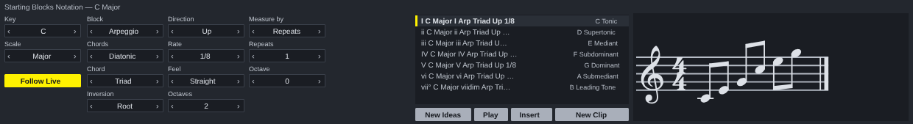

# Starting Blocks Notation for Ableton Live

A Max for Live MIDI effect. The blocks come from `reascripts/sb_engine.lua` and the notation from `sb_notate.lua`, `sb_draw.lua` and `sb_glyphs.lua`, the same files the REAPER script runs, unchanged.

## Installing

Needs **Live 12.1 or later with Max for Live** (Live Suite, or Standard with
the add-on): the device runs on Max 9's JavaScript engine (`[v8ui]`).

1. Copy `Starting Blocks Notation.amxd`, `StartingBlocksNotation.js` and `StartingBlocksNotation.maxpat` into one folder, for
   example `Music/Ableton/User Library/Presets/MIDI Effects/Max MIDI Effect/`. The `.amxd` finds
   `StartingBlocksNotation.js` beside it.
2. Drag `Starting Blocks Notation.amxd` onto a MIDI track, in front of an instrument.
3. Optional: open it in the Max editor and click **Freeze Device**, then save.
   The device then carries the script inside it and can be moved on its own.

## Using it

| | |
| --- | --- |
| **Key, Scale** | The key it writes in. **Follow Live** keeps it on Live's scale (the Scale button in the clip view) when that scale is one ScaleView knows. |
| The middle | The engine's settings, only the ones that apply. Click the right of a value for the next, the left for the one before, or drag up and down. **Part** appears when a result has several parts: all of them, or one. |
| The list | One block per degree of the key; the chosen one is engraved on the right, as Starting Blocks Notation prints it. Click one to hear it on the track's instrument. |
| **New Ideas** | Asks again, with a new number. |
| **Play** | Plays the chosen result again, or stops it. |
| **Insert** | Puts the chosen result where the button beside it says: **New Clip** (the first free slot on this track, from the selected scene down), **Arrangement** (at the insert marker; Live 12.2 or later) or **This Clip** (in place of the notes of the clip open in Detail View). A result with several parts puts the first on this track and each of the others on a new MIDI track beside it, named for the part. One undo step. |
| The score | The chosen block read as notation, in the key, engraved by `sb_notate.lua` and drawn with its own glyphs (Bravura, under the SIL Open Font Licence). |

The settings and the key are saved with the Live set.

## How it is built

`ableton/device.json` describes the device; `python3 ableton/kit/build.py
ableton/device.json` writes the `.amxd`, the `.maxpat` and the script bundle
`StartingBlocksNotation.js`. The bundle is Middaw's Lua 5.4 runtime, the engine and the notation files, the Noterator adapter (`ableton/adapters/`) and the shared window (`ableton/kit/generator.js`), whose score panel draws what Middaw's `engrave` call records. See `ableton/kit/VENDORED.md`.

`node --test ableton/tests/test_device.js` runs the device on a pretend Max and a pretend Live set: every setting stepped through, hearing a result (every note started is stopped), each way of inserting, a full track refused, following Live's scale, and saving and restoring with the set. Its own tests engrave every block of every kind and check F# major draws its six sharps.

## Limits

- **It has not been opened in Live yet.** It is tested in Node against a stand-in for Max and the Live Object Model; nothing has run in Max. If the `.amxd` will not open, open `StartingBlocksNotation.maxpat` in Max and save it as a device.
- Results are heard on whatever instrument is after the device, a few milliseconds late at worst: Max's JavaScript runs off the audio thread.
- Parts put on new tracks have no instrument yet: a device cannot load one.
- The score shows one block at a time; the REAPER window's page of blocks and its Print are not here.
